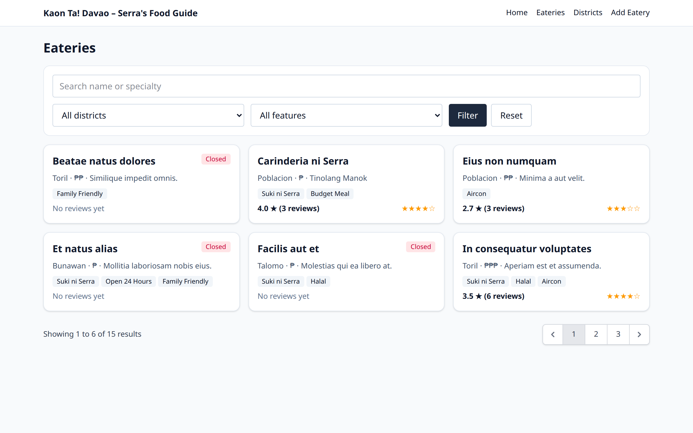
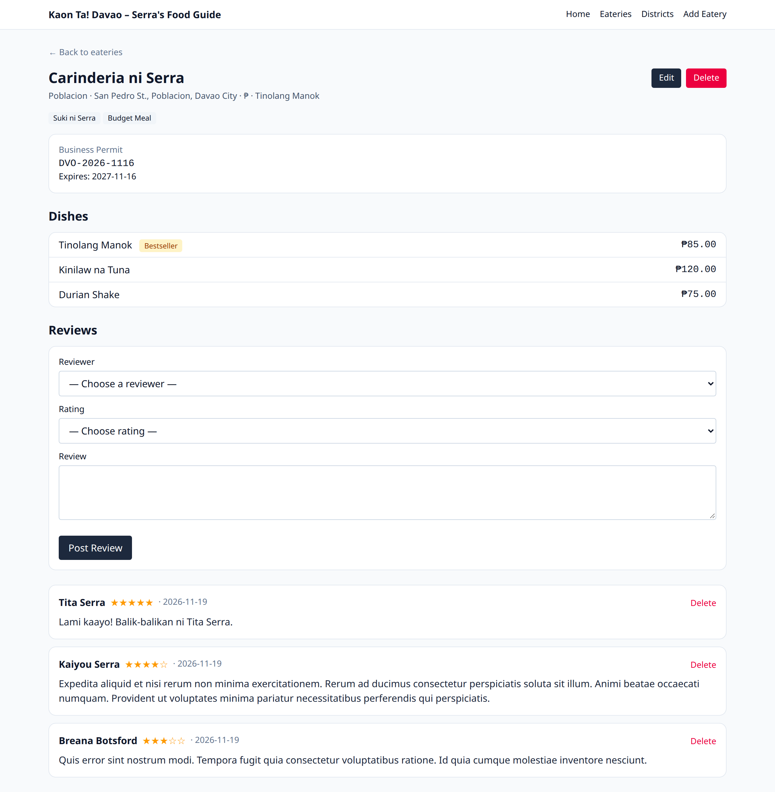
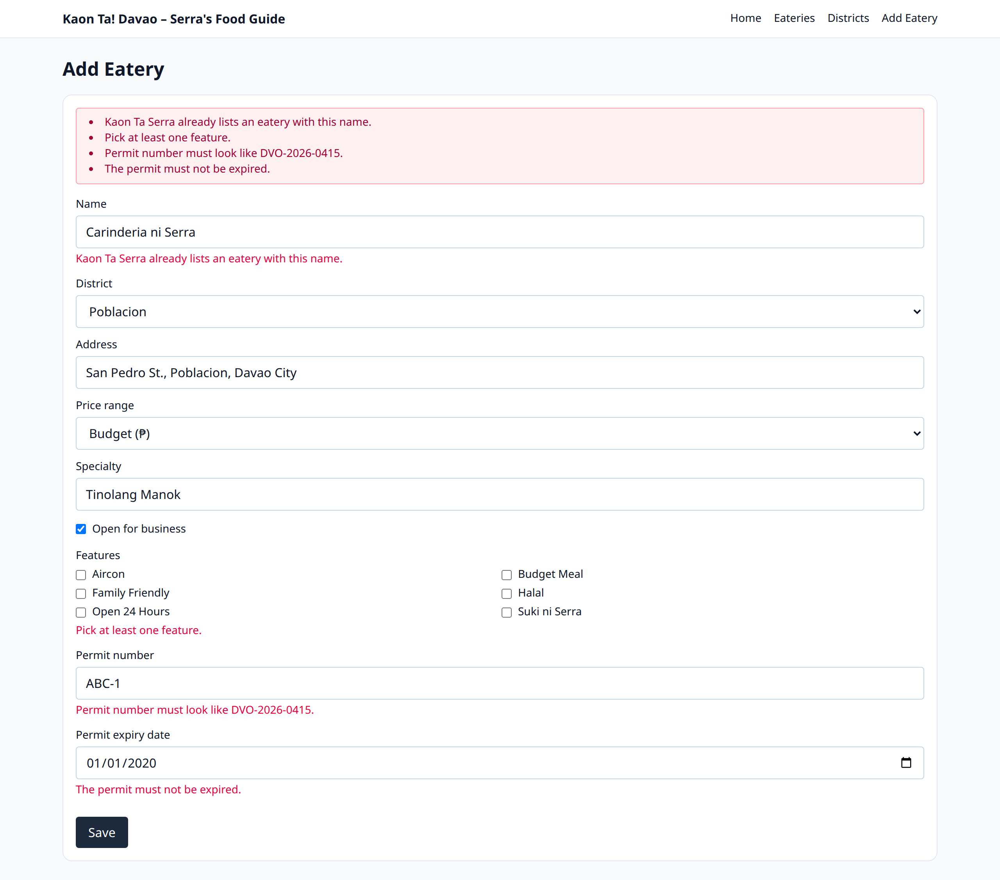

# PrefinalProject-Serra-KaonTaDavao

**Full name:** Kaiyou Serra

## Setup

Run these commands from a fresh clone:

```bash
composer install
cp .env.example .env
php artisan key:generate
touch database/database.sqlite
php artisan migrate:fresh --seed
npm install
npm run build
php artisan serve
```

> On Windows, substitute `Copy-Item .env.example .env` for `cp`, and
> `New-Item database/database.sqlite -ItemType File` for `touch`.

## Personalized Data

| Item | Value |
|---|---|
| Site title | Kaon Ta! Davao – Serra's Food Guide |
| Districts | Poblacion, Talomo, Agdao, Buhangin, Toril, Bunawan |
| Features | Suki ni Serra, Budget Meal, Halal, Open 24 Hours, Aircon, Family Friendly |
| User 1 | Kaiyou Serra — `serra@kaonta.test` (password: `kaonta2026`) |
| User 2 | Tita Serra — `tita.serra@kaonta.test` (password: `kaonta2026`) |
| My eatery | Carinderia ni Serra (slug: `carinderia-ni-serra`) |
| My permit | `DV0-2026-1116`, expiring `2027-11-16` |

## Relationships

| Relationship | Type | Why this type fits |
|---|---|---|
| District → Eatery | hasMany / belongsTo | A single district contains many eateries, but each eatery belongs to exactly one district, so the `district_id` foreign key lives on the `eateries` table and the relationship is one-to-many. |
| Eatery → Dish | hasMany / belongsTo | One eatery serves many dishes on its menu, while every dish belongs to exactly one eatery, so `eatery_id` lives on `dishes` — again one-to-many. |
| Eatery → Review | hasMany / belongsTo | An eatery can collect many reviews from different customers, but each review is tied to one eatery, so the `eatery_id` foreign key lives on `reviews`. |
| User → Review | hasMany / belongsTo | A reviewer can write reviews for many different eateries over time, but each review has exactly one author, so `user_id` lives on `reviews`. |
| Eatery → Permit | hasOne / belongsTo | Every eatery has exactly one business permit — enforced by the unique index on `permits.eatery_id` — and each permit belongs to one eatery, which is exactly what one-to-one means. |
| Eatery ↔ Feature | belongsToMany / belongsToMany | A single eatery can carry many features (Suki, Halal, Aircon…) and the same feature (e.g. Halal) applies to many eateries, so the pairings must live in a separate pivot table (`eatery_feature`) that belongs to both models. |
| District → Review (through Eatery) | hasManyThrough | Reviews are not directly attached to districts — they attach to eateries, and eateries attach to districts — so reaching reviews from a district means hopping through the `eateries` table via `hasManyThrough`. |

## Routes

Output of `php artisan route:list --except-vendor`:

```
  GET|HEAD        / ................................... home › HomeController
  GET|HEAD        districts ................... districts.index › DistrictController@index
  GET|HEAD        districts/{district} ........ districts.show › DistrictController@show
  GET|HEAD        eateries .................... eateries.index › EateryController@index
  POST            eateries .................... eateries.store › EateryController@store
  GET|HEAD        eateries/create ............. eateries.create › EateryController@create
  GET|HEAD        eateries/{eatery} ........... eateries.show › EateryController@show
  PUT|PATCH       eateries/{eatery} ........... eateries.update › EateryController@update
  DELETE          eateries/{eatery} ........... eateries.destroy › EateryController@destroy
  GET|HEAD        eateries/{eatery}/edit ...... eateries.edit › EateryController@edit
  POST            eateries/{eatery}/reviews ... eateries.reviews.store › ReviewController@store
  GET|HEAD        reviewers/{user} ............ reviewers.show › ReviewerController@show
  DELETE          reviews/{review} ............ reviews.destroy › ReviewController@destroy
```

## Screenshots






